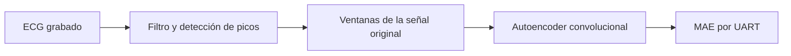

# Autoencoder de ECG en ESP32-S3

Prototipo de tesis que reconstruye latidos de ECG grabado con un autoencoder convolucional en una ESP32-S3. La placa devuelve por serie el error absoluto medio (MAE) de cada ventana. El modelo entrenado y dos tramos de prueba vienen incluidos.

[Descargá el ZIP](https://github.com/gianPerissutti/ecg-anomaly-esp32/archive/refs/heads/main.zip) o cloná el repositorio.

```sh
git clone https://github.com/gianPerissutti/ecg-anomaly-esp32.git
cd ecg-anomaly-esp32
```

## Compilación y carga

Usá una ESP32-S3 con 8 MB de flash. Conectala por un puente USB–UART de 3,3 V con reinicio automático por RTS. Si tu placa tiene dos conectores USB separados, usá el marcado **UART**.

Guardá el proyecto en una ruta sin espacios, activá ESP-IDF v5.5.1 y corré estos comandos desde la raíz del proyecto. La primera compilación descarga las versiones fijadas de ESP-DSP, ESP-NN y TensorFlow Lite Micro. [Instalación de ESP-IDF v5.5.1](https://docs.espressif.com/projects/esp-idf/en/v5.5.1/esp32s3/get-started/index.html)

```sh
idf.py build
idf.py -p /dev/ttyUSB0 flash
```

Reemplazá `/dev/ttyUSB0` por el puerto de tu placa y usá ese mismo puerto para la demo.

## Demo por serie

Creá un entorno Python e instalá pySerial. Los comandos usan una terminal de Linux o macOS.

```sh
python3 -m venv .venv
. .venv/bin/activate
python -m pip install -r requirements-demo.txt
python replay_demo.py /dev/ttyUSB0
```

Cerrá el monitor serie antes de correr la demo. El script reinicia la placa antes de cada tramo, envía las muestras y muestra el MAE que recibe. [Origen y verificación de los tramos de MIT-BIH](tests/fixtures/README.md)

Salida registrada en una corrida en la ESP32-S3.

```text
MIT-BIH 116 · MAE 0.016698, 0.024878
MIT-BIH 119 · MAE 0.038262
```

## Cómo funciona



El firmware compensa el retardo del filtro para ubicar los picos en la señal original. Cada ventana se normaliza antes de entrar al modelo. El MAE compara la ventana normalizada con la reconstrucción.

### Protocolo serie

- **UART0 a 115200, 8N1.** TX en GPIO43 y RX en GPIO44. La entrada son bloques consecutivos de 930 muestras `float32` little-endian en mV, a partir de una señal muestreada a 360 Hz.
- **Ventanas de 305 muestras.** La salida es un MAE decimal seguido de una coma por cada ventana procesada. Los mensajes de arranque salen por el mismo puerto.

### Archivos principales

- Recepción por UART, filtro y recorte de ventanas. [`main/main.cc`](main/main.cc)
- Inferencia con TensorFlow Lite Micro y cálculo del MAE. [`main/neural_network.cc`](main/neural_network.cc)
- Modelo entrenado en formato TensorFlow Lite, integrado en el firmware como arreglo de bytes. [`main/model.cc`](main/model.cc)
- Configuración de la placa y partición de aplicación de 3 MiB. [`sdkconfig.defaults`](sdkconfig.defaults) · [`partitions.csv`](partitions.csv)

## Créditos

Los archivos derivados de TensorFlow conservan sus avisos originales. Los extractos provienen de la MIT-BIH Arrhythmia Database de George Moody y Roger Mark. [Apache License 2.0](licenses/Apache-2.0.txt) · [MIT-BIH Arrhythmia Database](https://doi.org/10.13026/C2F305)
